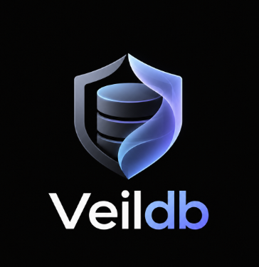
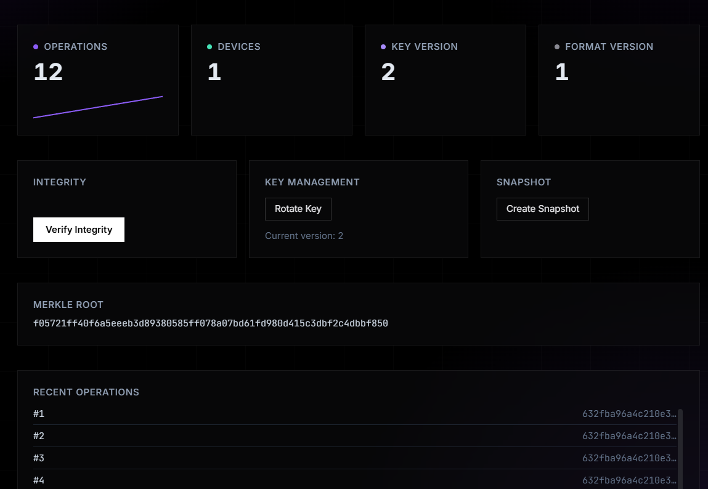
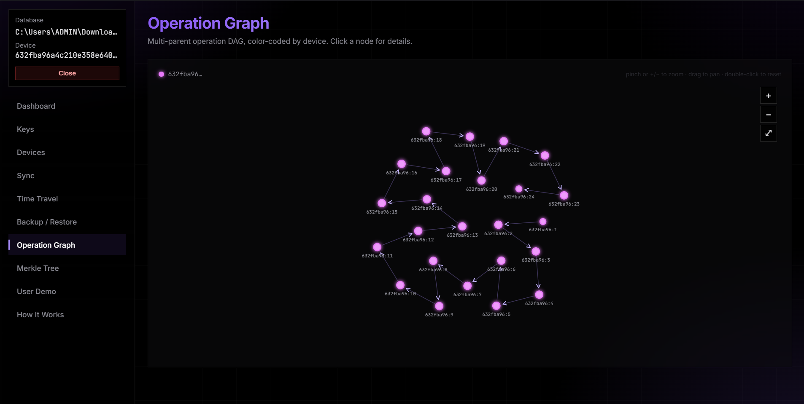
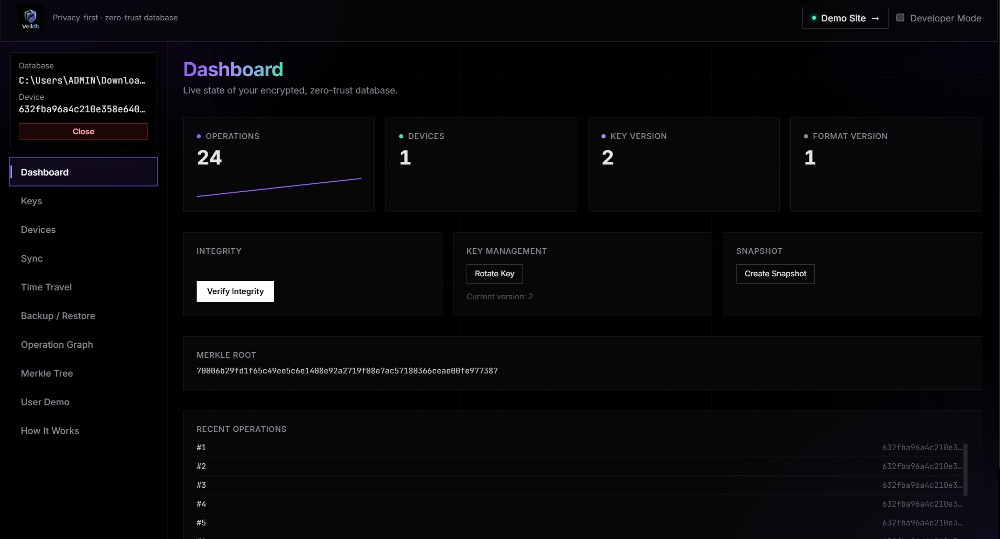
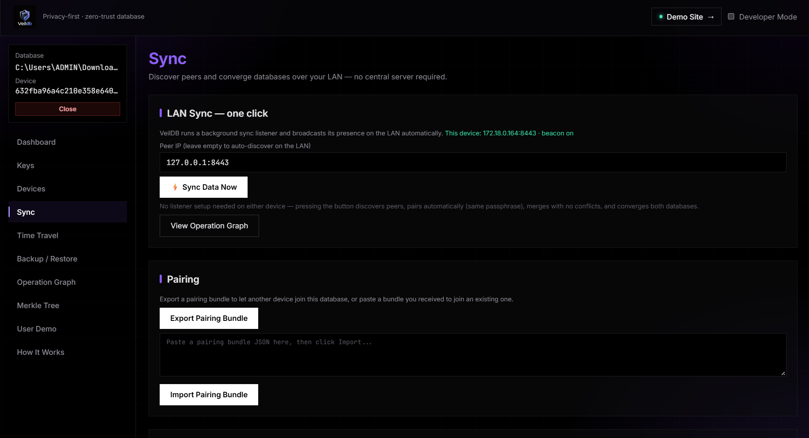

<div align="center">
  
  <h1>VeilDB</h1>
  <p><b>Privacy-first · local-first · zero-trust embedded database, written in Rust</b></p>
  <p>
    
    
    
    
    
  </p>
</div>

---

## Overview

VeilDB is an embedded key-value database where **your device is the only trusted party**:

- **SQLite is just the shelf.** Every write becomes an append-only, Ed25519-signed operation whose payload is AES-256-GCM ciphertext — the storage layer never sees plaintext.
- **Tamper evidence is cryptographic.** Every operation is BLAKE3-hashed and linked to its parents, forming a multi-parent **Merkle DAG**. `verify` re-hashes, re-signs and re-checks the graph — any bit flipped anywhere is detected.
- **History is immutable and queryable.** State is reconstructed by replaying the log, so any historical state can be queried — **time travel** via vector clocks (no wall-clock time anywhere).
- **Devices converge without a server.** An operation-based **CRDT** with deterministic conflict resolution merges concurrent writes identically on every device; sync runs peer-to-peer over your LAN (or through a blind relay over the internet) with zero-trust verification of every received operation.
- **Keys derive from your passphrase.** Argon2 key derivation from a passphrase + random 32-byte salt; key material is zeroized on drop and never crosses the CLI/Tauri API.

Everything ships as one workspace: **7 Rust library crates + a CLI + a Tauri 2 desktop app + a blind rendezvous relay + a React frontend**.

## Screenshots

> Save your screenshots to `docs/screenshots/` using the file names below.

**Dashboard** — live state of your encrypted, zero-trust database (operations, devices, key/format versions, integrity check, key rotation, snapshots, Merkle root, recent operations)



**Operation Graph** — the multi-parent operation DAG, color-coded by device. Zoom with pinch or `+`/`-`, pan by dragging, double-click to reset, click a node for details.



**Merkle Tree** — root at the top, branching down to the operation-hash leaves. Any tampered leaf changes the root.



**Sync** — one-click LAN sync (auto peer discovery + auto-pairing with the same passphrase) and pairing-bundle export/import. No central server required.



## Features

- **Local-first** — local storage is authoritative; sync is async and optional.
- **Zero-trust** — servers/relays only ever hold opaque ciphertext; every received operation's hash *and* signature are re-verified before merge.
- **Encrypted at rest** — AES-256-GCM per operation, fresh nonce every write, versioned keys (rotate without breaking history).
- **Cryptographic integrity** — BLAKE3 hashes + Merkle DAG + Ed25519 signatures; tamper detection with proofs and diffs.
- **Immutable history** — append-only operation log, always reconstructible.
- **Deterministic sync** — commutative/associative/idempotent CRDT merge; re-syncing is a no-op.
- **Time travel** — query any historical state via vector clock + replay.
- **Device-based trust** — bootstrap, approval, live revocation (effective on next handshake).
- **Fine-grained sharing** — hierarchical key wrapping (Master → Collection → Record).
- **Encrypted backup/restore** — validated, atomic restore (original untouched on failure).
- **One-click pairing** — signed pairing bundles carry *no key material*; peers re-derive the master key from the shared passphrase.
- **Beautiful tooling** — Tauri desktop GUI with DAG/Merkle visualizers, a 16-subcommand CLI, and a blind internet relay.

## How it works

### Write path

```text
CLI `put` / GUI `vdb_put`
  → validate key
  → serialize PutOp { key, value }
  → AES-256-GCM encrypt with your Argon2-derived master key     [crypto]
  → parents = current DAG tips · clock = current vector clock   [storage]
  → h = BLAKE3(canonical operation) · sign h with Ed25519       [integrity/crypto]
  → append in one SQLite transaction                            [storage]
  → returns OperationId (device_id, sequence)
```

### Verify path (tamper detection)

```text
verify → recompute BLAKE3 hash of every operation, compare to stored hash
       → verify every Ed25519 signature against the device's public key
       → validate the DAG (parents exist, no cycles)
       → rebuild the Merkle tree → report VERIFIED | TAMPERED
CLI exits with code 2 on tamper · GUI "Tamper Test" (Developer Mode) corrupts
an operation's ciphertext locally so you can watch detection fire.
```

### Sync path (zero-trust, 14 steps)

```text
1-2   Ed25519 challenge-response handshake + live trust check
3-6   exchange db metadata, Merkle roots, diff subtrees, list missing ops
7     transfer ciphertext operations
8-10  re-hash, re-verify signatures, validate the DAG — never trust the peer
11-14 CRDT merge → atomic apply → new Merkle root → commit
→ both devices converge; a second sync merges 0 operations (idempotent)
```

Pairing is one-click: a signed **pairing bundle** carries only `db_id` + salt +
public keys — **never key material**. Both devices share the passphrase, so both
derive the same master key locally.

## Architecture

Strict layering — **no crate may skip a layer**. Only `veildb-sync` (and the
`veildb-relay`, which only pipes sealed bytes) may cross a network boundary;
only `veildb-crypto` may touch key material; `veildb-storage` never sees
plaintext.

```text
                 ┌────────────┐  ┌────────────┐  ┌──────────────┐
                 │  cli (bin) │  │ bindings   │  │ relay (bin)  │  ← app layer
                 └─────┬──────┘  │ (Tauri 2)  │  └──────┬───────┘
                       │         └─────┬──────┘         │ (blind forwarder)
                       └───────┬───────┘                │
                        ┌──────▼──────┐                 │
                        │ veildb-core │  facade (VeilDbCore) — the only public API
                        └──┬───┬───┬──┴──┬─────┐        │
             ┌─────────────┘   │   │     │     └────┐   │
        ┌────▼────┐      ┌─────▼─┐ │  ┌──▼────┐ ┌───▼───▼──┐
        │ storage │◄─────┤ query │ │  │access │ │   sync   │
        └────▲────┘      └───┬───┘ │  └───┬───┘ └──┬───────┘
             │               │     │      │        │ (TCP :8443 / UDP beacon)
        ┌────┴────┐    ┌─────▼─────▼──────▼──┐     │
        │ crypto  │◄───┤    integrity        │     │
        └─────────┘    └─────────────────────┘     │
                                                   ▼
                                        other VeilDB devices / relay
```

| Crate | Role |
|---|---|
| `veildb-storage` | SQLite persistence only (rusqlite, WAL, migrations) — never sees plaintext |
| `veildb-crypto` | Sole owner of cryptography: AES-256-GCM, Ed25519, X25519, Argon2, BLAKE3, zeroizing `Key`/`KeyRing` |
| `veildb-integrity` | BLAKE3 operation hashes, Merkle tree + proofs, DAG validation, tamper reports |
| `veildb-query` | State reconstruction by replay, encrypted equality index, time travel, deterministic CRDT winner |
| `veildb-access` | Device trust/approval/revocation, key sharing (re-encrypted blobs), encrypted backup/restore |
| `veildb-sync` | The only network-crossing crate: 14-step zero-trust protocol, LAN/mock transports, UDP discovery, CRDT merge |
| `veildb-core` | `VeilDbCore` facade — the only app-facing API (24 methods) |
| `veildb-cli` | The `veildb` clap binary (depends only on core) |
| `veildb-bindings` | Tauri 2 shell: 27 `vdb_*` IPC commands, sync listener on `:8443`, discovery beacon (depends only on core) |
| `veildb-relay` | Blind rendezvous relay for cross-network sync — pairs devices by `BLAKE3(db_id)` and forwards their sealed bytes verbatim |

**Tech stack:** Rust (stable) · rusqlite/bundled SQLite · aes-gcm · ed25519-dalek ·
x25519-dalek · argon2 · blake3 · postcard · tokio · clap · Tauri 2 · React 18 ·
TypeScript · Vite 5 · Tailwind CSS 3.

## Quick start

### Prerequisites

- **Rust** stable (1.75+) — [rustup](https://rustup.rs)
- **Node.js** 18+ and npm
- **WebView2 runtime** on Windows (required by Tauri)

### 1. Clone & test

```bash
git clone https://github.com/ManoharGouda00/vei.git
cd vei

cargo test --workspace          # 71 tests
cargo build -p veildb-cli
```

### 2. Use the CLI

Global options: `-d/--db <path>` (default `veildb.vdb`) and `--passphrase <pw>`
(omit to be prompted). Exit codes: `0` success · `1` error · `2` integrity failure.

```bash
veildb --db demo.vdb --passphrase secret init
veildb --db demo.vdb --passphrase secret put greeting "hello"
veildb --db demo.vdb --passphrase secret get greeting
veildb --db demo.vdb --passphrase secret status
veildb --db demo.vdb --passphrase secret verify    # Integrity: VERIFIED
```

<details>
<summary><b>Full CLI reference (16 subcommands)</b></summary>

```text
veildb init                                initialize a new database
veildb put <key> <value>                   write a value (encrypted operation)
veildb get <key>                           read a value
veildb verify                              verify integrity (hashes, signatures, DAG, Merkle)
veildb log [--at device:counter,...]       operation log / time-travel query
veildb status                              db_id, op count, Merkle root, clock, devices, key version
veildb snapshot                            create a snapshot (compaction checkpoint)
veildb merges                              deterministic conflict-resolution log
veildb discover [--timeout-ms N]           UDP multicast peer discovery
veildb sync --backend lan [--addr A] [--listen]   dial or accept one sync session
veildb device list                         list devices + trust state
veildb device trust <pubkey-hex>           trust a new device
veildb device revoke <device-id-hex>       revoke (effective on next handshake)
veildb device export-pairing <file>        signed pairing bundle (db_id + salt, no keys)
veildb device import-pairing <file>        adopt bundle identity + approve approver
veildb device rotate-key                   rotate the master key (new key version)
veildb share <key> --to <device-id-hex>    wrap a record key for a device
veildb backup <output>                     encrypted backup archive
veildb restore <archive>                   validated, atomic restore
```

</details>

### 3. Run the frontend

```bash
cd frontend
npm install
npm run dev        # http://localhost:1420 — works in-browser via a full mock API
npm run build      # tsc && vite build → dist/
```

The frontend's `mockApi.ts` detects the Tauri runtime: inside the desktop
webview it proxies to the real `vdb_*` commands; in a plain browser it serves a
fully functional in-memory mock, so **the whole UI works without Rust**.

### 4. Run the desktop app (Tauri)

```bash
# one terminal — Vite dev server (needed by the debug build's devUrl)
cd frontend && npm run dev

# another terminal — the app
cargo build -p veildb-bindings
./target/debug/veildb-bindings.exe     # window "VeilDB"
```

For a standalone build, run `npm run build` first so `bindings` can bundle
`frontend/dist`. Crash/error logs: `veildb-crash.log`, `veildb-error.log`.

### 5. Two devices in 60 seconds

```bash
# Device A
veildb device export-pairing pair.json

# copy pair.json to Device B (same passphrase on both)
veildb device import-pairing pair.json

# Device B — accept one sync session
veildb sync --backend lan --listen --addr 0.0.0.0:8443

# Device A — dial B
veildb sync --backend lan --addr <B-IP>:8443
# → identical Merkle roots on both; run again → 0 ops merged (idempotent)
```

The desktop app does all of this with one button: **Sync → Sync Data Now**
(auto-discovery + auto-pairing on the LAN).

## Internet sync with the relay

LAN not available? Run the **blind rendezvous relay** on any reachable host
(VPS, cloud instance, a friend's machine):

```bash
cargo build -p veildb-relay
./target/debug/veildb-relay --listen 0.0.0.0:8444
```

Both devices point at it (Sync → *Connect over internet*). The relay pairs them
by `BLAKE3(db_id)` room and pipes their **already-encrypted** bytes verbatim —
it never sees keys, plaintext, index tokens, or operation content.

## Desktop app tour

The Tauri shell wraps the React dashboard (10 tabs). The sidebar always shows
the open database path and this device's ID; the header has **Developer Mode**
(toggles the destructive *Tamper Test* tab) and a **Demo Site** link (`#demo`).

| Tab | What it does |
|---|---|
| **Dashboard** | Live stats (operations, devices, key/format version), Verify Integrity, Rotate Key, Create Snapshot, current Merkle root, recent operations |
| **Keys** | Share a wrapped key with a device, rotate the master key |
| **Devices** | List devices, trust / revoke (revocation is live on next handshake) |
| **Sync** | One-click LAN sync (beacon + auto-discovery + auto-pairing), pairing-bundle export/import, sync & merge logs |
| **Time Travel** | Query the database as of any logical clock — replay history |
| **Backup / Restore** | Encrypted backup archive and validated restore via native file dialog |
| **Operation Graph** | Interactive multi-parent DAG, color-coded by device, click a node for details |
| **Merkle Tree** | Interactive Merkle tree — root at top, operation-hash leaves below, with proofs |
| **Tamper Test** *(Developer Mode)* | Corrupt an operation's ciphertext locally, then re-verify to watch tamper detection fire |
| **User Demo** | Sign-up/sign-in demo whose credentials are stored *in VeilDB itself* via `vdb_put` as encrypted key-value pairs |
| **How It Works** | Illustrated explainer: tech stack, system design, the sealed-record envelope, encryption journey, write/read paths, VeilDB vs a traditional database |

All GUI traffic goes through 27 `vdb_*` Tauri commands with a uniform
`{ success, data, error }` envelope — **no key material ever crosses IPC**, and
every instance runs a background sync listener on port `8443` plus a
discovery beacon (every 1500 ms).

## Testing

`cargo test --workspace` — **71 tests, 0 failures**:

| Suite | Tests | Covers |
|---|---:|---|
| `veildb-storage` | 12 | schema/migrations, append/duplicates, clock advance/merge/dominance |
| `veildb-crypto` | 15 | AES round-trip, sign/verify/tamper, X25519, Argon2, key rotation, zeroize |
| `veildb-integrity` | 13 | Merkle build/proof/diff, verify OK/tampered, cycle & missing-parent detection |
| `veildb-query` | 10 | reconstruction, order-independent CRDT convergence, causal dominance, time travel |
| `veildb-access` | 14 | trust/approve/revoke, backup/restore, partial-restore rejection |
| `veildb-sync` | 13 | mock/LAN backends, full session flow, discovery signing/tamper |
| `veildb-core` | 3 | facade integration |
| `veildb-cli` (integration) | 3 | **two real processes**: pairing + sync convergence, deterministic merge, live revocation |

```bash
cargo test --workspace
cargo clippy --workspace --all-targets --all-features
cd frontend && npm run build     # tsc type-check + vite bundle
```

## Project layout

```text
vei/                          Cargo workspace root
├── Cargo.toml                10 members, shared dependency versions
├── rust-toolchain.toml       channel = stable (+ rustfmt, clippy)
├── crates/
│   ├── storage/              SQLite persistence only
│   ├── crypto/               all cryptography (sole owner)
│   ├── integrity/            BLAKE3 hashing, Merkle DAG, tamper detection
│   ├── query/                replay, indexes, time travel, CRDT winner
│   ├── access/               device trust, sharing, backup/restore
│   ├── sync/                 14-step zero-trust protocol + transports + discovery
│   └── core/                 VeilDbCore facade — the only app-facing API
├── cli/                      `veildb` clap binary + 2-process integration tests
├── bindings/                 Tauri 2 shell (27 `vdb_*` commands, listener :8443)
├── relay/                    blind rendezvous relay (forwards sealed bytes only)
├── frontend/                 React 18 + TypeScript + Vite 5 + Tailwind 3
├── docs/                     PROJECT_STRUCTURE.md, cod.md, validation logs, screenshots/
└── testing/                  (runtime artifacts — gitignored)
```

~8,300 lines of Rust · ~3,800 lines of TypeScript.

## Security

**Properties:**

- Your passphrase is never stored; the master key lives only in memory and is **zeroized on drop**.
- Everything at rest is encrypted (AES-256-GCM, per-operation nonce, versioned keys) — a stolen database file reveals nothing.
- Every operation is Ed25519-signed; BLAKE3 + the Merkle DAG make history tamper-evident.
- Sync is **zero-trust**: the peer's hashes, signatures and DAG are re-verified locally before any merge; trust is checked live, so revocation takes effect on the next handshake.
- Pairing bundles are signed but **not secret** — they carry no key material.
- The relay and any relay-host see only opaque ciphertext identifiers; the storage, integrity and sync layers structurally cannot see plaintext.
- The debug-only `corrupt_operation` API (powering the Tamper Test tab) is compiled out of release builds.

**Known limitations:**

- `CloudBackend` / `P2pBackend` sync transports are intentional stubs (`NotImplemented`); LAN and relay modes are implemented.
- The GUI dev flow needs the Vite server running (debug builds embed `devUrl :1420`).
- Vendored SQLite (`bundled` feature) means larger binaries, in exchange for zero system dependencies.
- Report security issues responsibly — please open a GitHub security advisory rather than a public issue.

## Documentation

| Document | Contents |
|---|---|
| [`docs/PROJECT_STRUCTURE.md`](docs/PROJECT_STRUCTURE.md) | Full reference: file tree, data model, SQLite schema, crate-by-crate internals, end-to-end flows, test inventory |
| [`docs/cod.md`](docs/cod.md) | Implementation change log + two-device run book |
| [`docs/multi-device-validation.md`](docs/multi-device-validation.md) | Captured real two-process sync session output |
| In-app **How It Works** tab | Illustrated explainer of the architecture and encryption |

## Contributing

Issues and pull requests are welcome.

1. Fork and create a feature branch: `git checkout -b feature/my-change`
2. Make sure `cargo test --workspace` passes (71 tests) and `cargo clippy --workspace --all-targets --all-features` stays warning-free
3. For frontend changes, also run `npm run build` in `frontend/`
4. Open a pull request describing the change and its tests

## License

Licensed under the **MIT License** — see [LICENSE](LICENSE) for the full text.

---

<div align="center">
  <b>VeilDB</b> — privacy-first · local-first · zero-trust<br/>
  Your data. Your devices. Your keys.
</div>


